<a href="https://dlk25.com"></a>

```
DAN(1)                      General Commands Manual                      DAN(1)

NAME
       dan - Dan Lorntzsen Kaupang, developer

SYNOPSIS
       dan [--coffee] [--deadline=tomorrow] problem...

DESCRIPTION
       dan turns marketing problems into code: email templates, CRM journeys,
       the web pages around them, and the small tools that get a campaign out
       the door without anyone copying and pasting at midnight.

       He works at Bas Kommunikasjon in Oslo, and builds side projects in the
       evenings, mostly with Claude Code as a pair.

OPTIONS
       --coffee
              Required. Behaviour without it is undefined.

       --editor=vim
              The default. Cannot be overridden. Has been tried.

BUGS
       Estimates are optimistic by a factor of pi.
       Will rewrite your build script "while he's in there".

SEE ALSO
       touchtype(6), gamesounds(6), dlk25(7), buddy(6)
```

### `~/projects`

| | |
|---|---|
| [**touchtype**](https://touchtype.dlk25.com) | A touch typing trainer that looks like a terminal and measures where your time actually goes. |
| [**gamesounds**](https://gamesounds.dlk25.com) | A daily quiz where you name the video game from its sound. Seven sounds, one attempt. |
| [**dlk25.com**](https://dlk25.com) | My site, which is a terminal. Type `help`, or `ls -a` if you are that kind of person. |
| [**bas-skills**](https://github.com/suntandan/bas-skills) | Claude skills for email marketing work. |

### `~/notes`

- [Parallel agents and git worktrees](https://dlk25.com/notes/parallel-agents-and-worktrees)
- [Rules or machinery](https://dlk25.com/notes/rules-or-machinery)
- [What an agentic harness is](https://dlk25.com/notes/agentic-harness)
- [Running my own mail server](https://dlk25.com/notes/mailserver)
- [WebP with a GIF fallback in email](https://dlk25.com/notes/webp-in-email)

### `~/.plan`

```
$ finger dan
Login: dan                              Name: Dan Lorntzsen Kaupang
Mail:  dan@dlk25.com                    Web:  dlk25.com
Plan:
       Open to chat about side projects and collaborations.
```

[dlk25.com](https://dlk25.com) · [dan@dlk25.com](mailto:dan@dlk25.com) · [LinkedIn](https://www.linkedin.com/in/dan-lorntzsen-kaupang-b3012730)

<sub>The figure in the terminal is buddy. He lives at the bottom of dlk25.com and has opinions about what you type.</sub>
